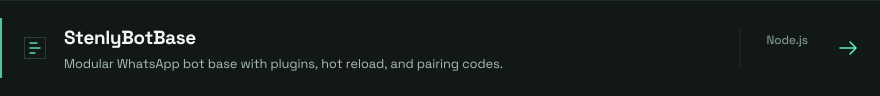
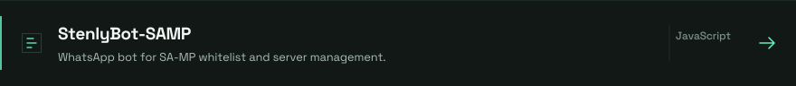
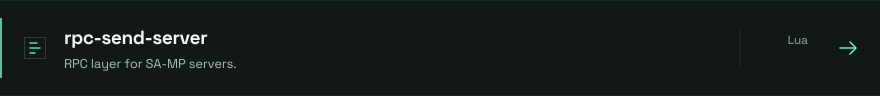
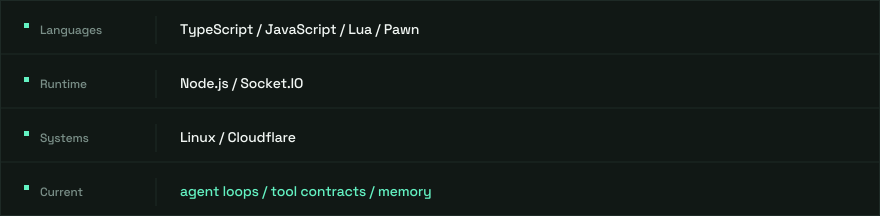
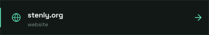

  

Currently focused on AI agents: tool use, memory, and execution loops. My background is in multiplayer game servers, RPC, and automation.

Based in Indonesia. Most of my work is private; the public pieces are below.

  <picture>
  <source media="(max-width: 760px)" srcset="./assets/title-focus-mobile.svg">
  
</picture>

  <picture>
  <source media="(max-width: 760px)" srcset="./assets/focus-mobile.svg">
  
</picture>

  

Observe, plan, act, then verify what changed.

  <picture>
  <source media="(max-width: 760px)" srcset="./assets/title-work-mobile.svg">
  
</picture>

Projects from the server and automation side:

  <a href="https://github.com/glarceny/StenlyBotBase"><picture>
    <source media="(max-width: 760px)" srcset="./assets/work-botbase-mobile.svg">
    
  </picture></a> 
  <a href="https://github.com/glarceny/StenlyBot-SAMP"><picture>
    <source media="(max-width: 760px)" srcset="./assets/work-samp-mobile.svg">
    
  </picture></a> 
  <a href="https://github.com/glarceny/rpc-send-server-0.3.7dl"><picture>
    <source media="(max-width: 760px)" srcset="./assets/work-rpc-mobile.svg">
    
  </picture></a>

  <picture>
  <source media="(max-width: 760px)" srcset="./assets/title-stack-mobile.svg">
  
</picture>

  <picture>
  <source media="(max-width: 760px)" srcset="./assets/stack-mobile.svg">
  
</picture>

  <picture>
  <source media="(max-width: 760px)" srcset="./assets/title-contact-mobile.svg">
  
</picture>

  
  &nbsp;&nbsp;
  

  <picture>
  <source media="(max-width: 760px)" srcset="./assets/footer-mobile.svg">
  
</picture>

