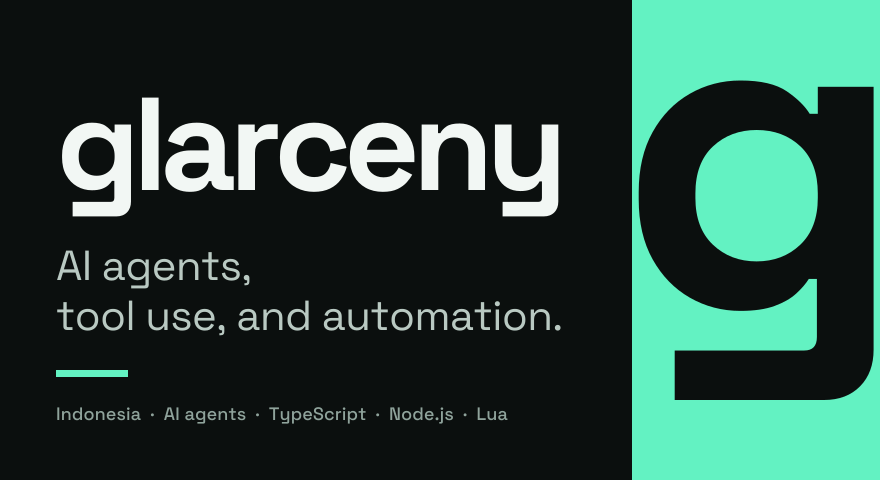
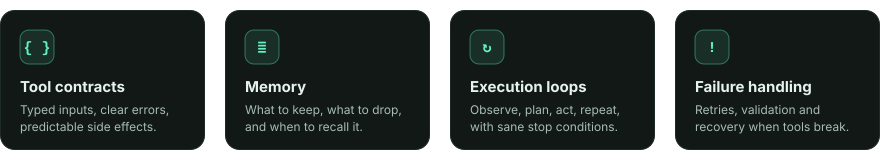
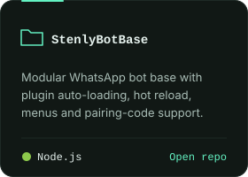
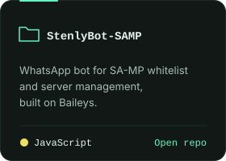
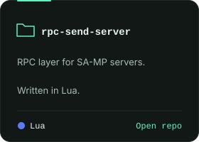
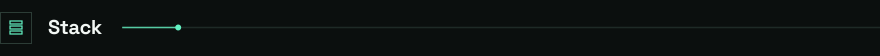
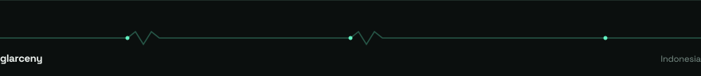

  

  Currently focused on <b>AI agents</b>: tool use, memory, and execution loops. 
  Background in multiplayer game servers, RPC, and automation. Based in Indonesia. 
  Most of my work is private; the public pieces are below.

 

  The interesting part is the loop around the model.

  

 

Projects from the server and automation side.

<table align="center">
  <tr>
    <td></td>
    <td></td>
    <td></td>
  </tr>
</table>

 

  

 

  
  &nbsp;
  

  

